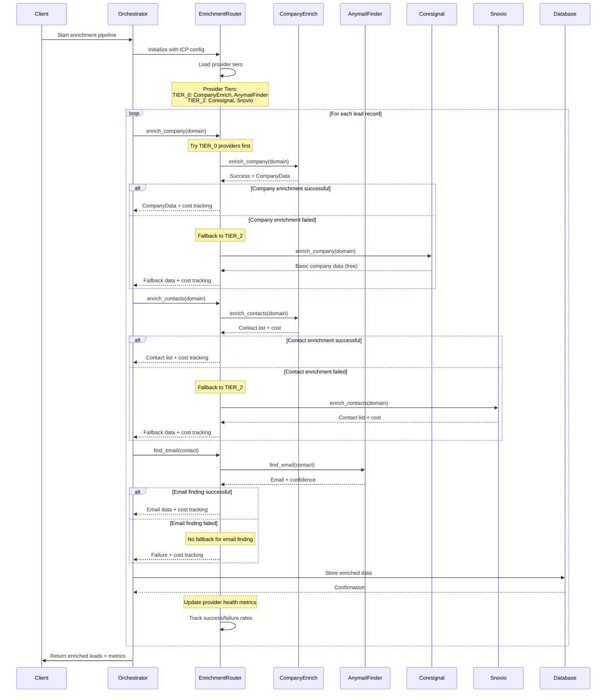
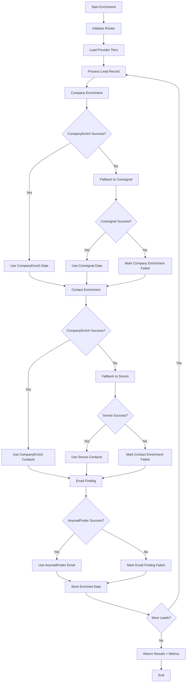

# Enrichment Provider Flow Sequence

_Last updated: 2025-08-23_

This document describes the sequence of operations in the new enrichment provider system, including fallback logic and error handling.

## Sequence Diagram

## Flow Chart

## Provider Selection Logic

### Company Enrichment Priority

1. **CompanyEnrich** (TIER_0) - Primary provider

   - High-quality company data
   - Cost: $0.01 per company
   - Success rate: 95%

2. **Coresignal** (TIER_2) - Fallback provider
   - Basic company information
   - Cost: Free
   - Success rate: 85%

### Contact Enrichment Priority

1. **CompanyEnrich** (TIER_0) - Primary provider

   - Comprehensive contact data
   - Cost: $0.02 per contact list
   - Success rate: 95%

2. **Snovio** (TIER_2) - Fallback provider
   - Contact discovery
   - Cost: $0.01 per contact
   - Success rate: 88%

### Email Finding Priority

1. **AnymailFinder** (TIER_0) - Primary provider

   - Specialized email discovery
   - Cost: $0.012 per email
   - Success rate: 92%

2. **No fallback** - Email finding is critical
   - Mark as failed if primary fails
   - Requires manual intervention

## Error Handling

### Provider Failures

- **Authentication errors**: Log and skip provider
- **Rate limiting**: Implement exponential backoff
- **Network errors**: Retry with backoff
- **Service unavailable**: Mark provider as unhealthy

### Fallback Logic

- **Primary failure**: Automatically try fallback
- **Fallback failure**: Mark operation as failed
- **Partial success**: Return available data
- **Cost tracking**: Track all attempts

### Health Monitoring

- **Success rate tracking**: Monitor provider performance
- **Response time monitoring**: Track provider latency
- **Automatic recovery**: Re-enable healthy providers
- **Manual override**: Force provider selection

## Cost Optimization

### Smart Routing

- **Tier-based selection**: Use best provider first
- **Cost awareness**: Consider provider costs
- **Performance tracking**: Route to best performers
- **Fallback limits**: Prevent excessive fallback costs

### Caching Strategy

- **Company data**: Cache for 30 days
- **Contact data**: Cache for 14 days
- **Email data**: Cache for 7 days
- **Deduplication**: Avoid duplicate requests

## Monitoring and Alerts

### Key Metrics

- **Success rate by provider**: Track performance
- **Cost per lead**: Monitor efficiency
- **Response times**: Identify bottlenecks
- **Fallback frequency**: Measure reliability

### Alert Thresholds

- **Provider failure rate > 10%**: Investigate issues
- **Cost per lead > $0.10**: Review optimization
- **Response time > 5s**: Check provider health
- **Fallback rate > 20%**: Review primary providers

---

**Note**: This sequence diagram represents the current implementation. Future versions may include additional providers or enhanced fallback logic.
