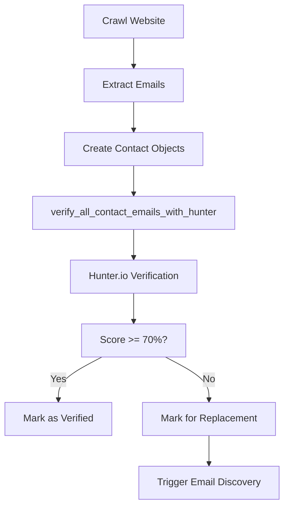
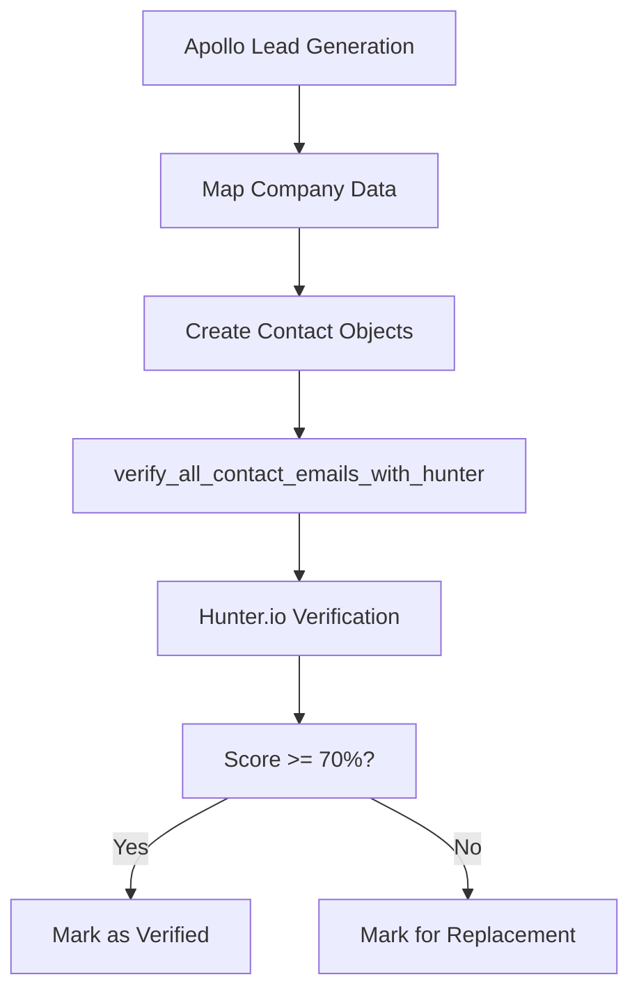
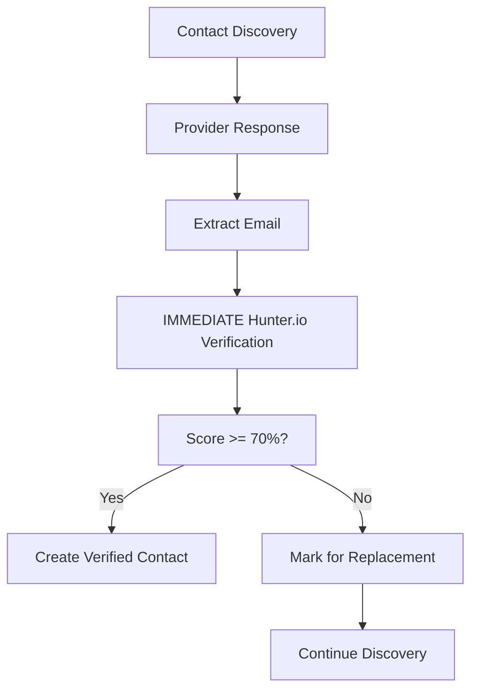
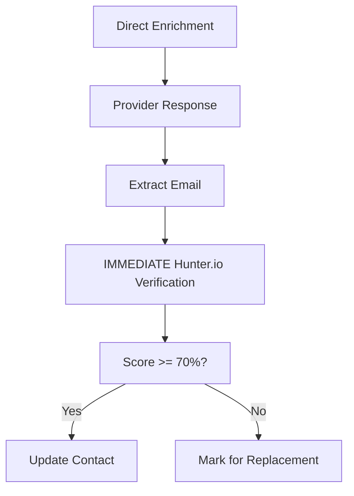
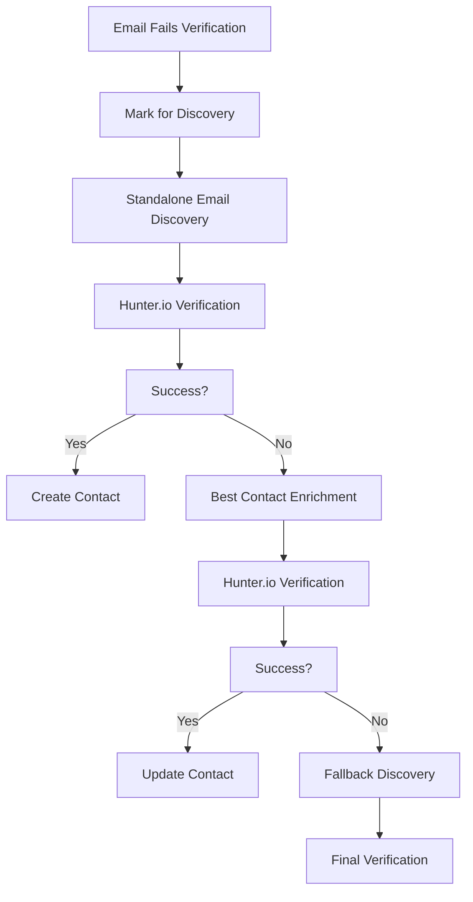

# 🎯 Hunter.io Email Verification Integration Guide

## 📋 **Overview**

This document provides comprehensive documentation of the Hunter.io email verification integration in the Lead Sorcerer pipeline. The system ensures that **ALL** emails from **ANY** source are verified with Hunter.io before being used in lead generation or enrichment processes.

## 🏗️ **Architecture Overview**

### **Integration Points**
- **Crawl Tool**: Emails extracted from websites
- **Apollo Tool**: Emails from Apollo lead generation
- **Contact Discovery**: Emails from various enrichment providers
- **Direct Enrichment**: Emails from direct contact enrichment
- **Standalone Discovery**: Emails from email discovery workflows
- **Best Contact Enrichment**: Emails from best contact selection

### **Core Components**
- **HunterIOClient**: Main verification client with caching and error handling
- **Verification Functions**: Universal email verification functions
- **Cost Tracking**: Integration with existing cost management
- **Performance Optimization**: Caching and batch processing
- **Error Handling**: Robust retry logic with exponential backoff

---

## 🔄 **Email Verification Flow**

### **1. Email Entry Points**

#### **1.1 Crawl Tool Integration**


**Implementation Location:** `src/crawl.py` lines 2479-2497
**Key Function:** `_process_extracted_data()`

#### **1.2 Apollo Tool Integration**


**Implementation Location:** `src/apollo/lead_gen.py` around line 920
**Key Function:** `_map_company_to_unified_schema()`

#### **1.3 Contact Discovery Integration**


**Implementation Location:** `src/enrich.py` lines 2944, 2984
**Key Function:** `_process_contact_discovery()`

#### **1.4 Direct Enrichment Integration**


**Implementation Location:** `src/enrich.py` lines 3313, 3337, 3379
**Key Function:** `_enrich_contact_directly()`

### **2. Verification Decision Logic**

#### **2.1 Score Thresholds**
- **0% Score**: Immediate discard, trigger discovery
- **1-69% Score**: Mark for replacement, keep for fallback
- **70-100% Score**: Accept and use

#### **2.2 Quality Gates**
```python
def apply_hunter_verification(contact, hunter_result, min_score=70):
    score = hunter_result.get("score", 0)
    status = hunter_result.get("status", "unknown")
    
    if score == 0:
        # Immediate discard
        contact["email"] = None
        contact["email_source"] = []
        contact["needs_email_discovery"] = True
        contact["hunter_verification"] = hunter_result
        return False
    
    elif score >= min_score and status in ["valid", "deliverable"]:
        # Accept email
        contact["email_verified"] = True
        contact["email_source"].append("hunter_verified")
        contact["hunter_verification"] = hunter_result
        contact["email_quality_score"] = score
        return True
    
    else:
        # Mark for replacement
        contact["email_verified"] = False
        contact["needs_email_replacement"] = True
        contact["hunter_verification"] = hunter_result
        contact["email_quality_score"] = score
        return False
```

### **3. Fallback and Recovery**

#### **3.1 Email Discovery Workflow**


#### **3.2 Discovery Priority**
1. **Standalone Discovery**: Direct email lookup
2. **Best Contact Enrichment**: Contact-level enrichment
3. **Fallback Discovery**: Comprehensive provider search

---

## 🛠️ **Technical Implementation**

### **1. HunterIOClient Class**

#### **1.1 Core Features**
- **Rate Limiting**: 10 requests/second with semaphore control
- **Caching**: Configurable TTL and size limits
- **Error Handling**: Exponential backoff with retry logic
- **Performance Monitoring**: Response time and cache statistics

#### **1.2 Configuration Options**
```python
class HunterIOClient:
    def __init__(self, api_key: str, cache_ttl_hours: int = 24, max_cache_size: int = 10000):
        # Performance optimization
        self.cache_ttl_hours = cache_ttl_hours
        self.max_cache_size = max_cache_size
        
        # Error handling
        self.max_retries = 3
        self.base_delay = 1.0
        self.max_delay = 60.0
        
        # Rate limiting
        self.rate_limiter = asyncio.Semaphore(10)
```

#### **1.3 Error Handling Strategy**
```python
def _should_retry(self, status_code: int, error: Exception) -> bool:
    # Always retry on rate limits
    if status_code == 429:
        return True
    
    # Retry on server errors (5xx)
    if status_code >= 500:
        return True
    
    # Retry on timeouts and connection errors
    if isinstance(error, (httpx.TimeoutException, httpx.ConnectError, httpx.ReadError)):
        return True
    
    # Don't retry on client errors (4xx except 429) or authentication errors
    if (400 <= status_code < 500 and status_code != 429) or status_code == 401:
        return False
    
    return False
```

### **2. Verification Functions**

#### **2.1 Universal Verification**
```python
async def verify_all_contact_emails_with_hunter(
    contacts: List[Dict[str, Any]],
    hunter_client: HunterIOClient,
    domain: str,
    logger: logging.Logger,
    costs_config: Dict[str, Any],
    min_score: int = 70
) -> Tuple[List[Dict[str, Any]], float]:
    """
    Verify all contact emails with Hunter.io.
    
    Args:
        contacts: List of contact dictionaries
        hunter_client: Configured Hunter.io client
        domain: Domain for logging context
        logger: Logger instance
        costs_config: Cost tracking configuration
        min_score: Minimum acceptable email score
        
    Returns:
        Tuple of (verified_contacts, total_cost)
    """
```

#### **2.2 Batch Verification**
```python
async def verify_emails_batch(
    self, 
    emails: List[str], 
    logger: Optional[logging.Logger] = None, 
    max_concurrent: int = 5
) -> List[Dict[str, Any]]:
    """
    Verify multiple emails concurrently with controlled concurrency.
    
    Features:
    - Cache-first approach for efficiency
    - Controlled concurrency with semaphores
    - Error handling for individual emails
    - Results returned in original order
    """
```

### **3. Cost Tracking Integration**

#### **3.1 Cost Structure**
- **Hunter.io Verification**: $0.002 per email
- **Enrichment Costs**: Provider-specific costs
- **Discovery Costs**: Email discovery provider costs

#### **3.2 Cost Tracking Implementation**
```python
# Track Hunter.io costs
contact_cost += hunter_result.get("cost_usd", 0.002)

# Update total costs
total_hunter_cost += hunter_result.get("cost_usd", 0.002)

# Log cost information
logger.info(f"💰 Hunter.io verification cost: ${hunter_result.get('cost_usd', 0.002):.4f}")
```

---

## 📊 **Data Schema and Fields**

### **1. Hunter.io Verification Fields**

#### **1.1 Core Verification Data**
```json
{
  "hunter_verification": {
    "email": "string",
    "score": "integer (0-100)",
    "status": "string (valid/invalid/risky/etc)",
    "result": "string (deliverable/undeliverable/etc)",
    "disposable": "boolean",
    "webmail": "boolean",
    "mx_record": "boolean",
    "smtp_server": "string|null",
    "smtp_check": "boolean",
    "cost_usd": "number",
    "retry_attempts": "integer",
    "http_status": "integer"
  }
}
```

#### **1.2 Contact Quality Fields**
```json
{
  "email_quality_score": "integer (0-100)",
  "email_verified": "boolean",
  "needs_email_replacement": "boolean",
  "needs_email_discovery": "boolean",
  "email_source": ["array of sources"],
  "costs": {
    "hunter_io": "number",
    "enrichment": "number",
    "discovery": "number"
  }
}
```

### **2. ICP Configuration Schema**

#### **2.1 Hunter.io Configuration**
```json
{
  "hunter_io": {
    "enabled": "boolean",
    "min_score": "integer (0-100)",
    "max_verifications_per_contact": "integer",
    "fallback_discovery": "boolean",
    "cost_tracking": "boolean"
  }
}
```

#### **2.2 Performance Optimization**
```json
{
  "hunter_io": {
    "performance_optimization": {
      "caching": {
        "enabled": "boolean",
        "ttl_hours": "integer",
        "max_size": "integer"
      },
      "batch_verification": {
        "enabled": "boolean",
        "max_concurrent": "integer",
        "batch_threshold": "integer"
      },
      "error_handling": {
        "enabled": "boolean",
        "max_retries": "integer",
        "base_delay": "number",
        "max_delay": "number"
      }
    }
  }
}
```

---

## 🔍 **Monitoring and Logging**

### **1. Logging Patterns**

#### **1.1 Verification Logs**
```
🔍 Hunter.io: Starting verification for john@example.com
📊 Hunter.io Results for john@example.com: Score=85%, Status=valid, Result=deliverable, Response time: 0.234s, Attempts: 1
✅ Email verified: john@example.com (score: 85%)
```

#### **1.2 Error and Retry Logs**
```
⚠️ Hunter.io rate limit exceeded for john@example.com (attempt 1)
⏳ Hunter.io: Waiting 2.1s before retry due to rate limit
🔄 Hunter.io: Retry attempt 2/3 for john@example.com
```

#### **1.3 Performance Logs**
```
📊 Hunter.io Performance: Avg response: 234.1ms, Cache hit rate: 45.2%
🛡️ Hunter.io Error Handling: Retries: 5, Failed: 2, Rate limits: 3, Timeouts: 1, Success rate: 85.7%
💰 Hunter.io verification completed for example.com: 15 verified, 2 failed, 1 discarded (0% score), Total cost: $0.0360
```

### **2. Performance Metrics**

#### **2.1 Cache Statistics**
- **Cache Hit Rate**: Percentage of requests served from cache
- **Cache Size**: Current number of cached entries
- **Cache Efficiency**: Memory usage and cleanup frequency

#### **2.2 Error Handling Metrics**
- **Retry Success Rate**: Percentage of retries that succeed
- **Error Distribution**: Breakdown by error type
- **Response Time Impact**: Effect of retries on performance

#### **2.3 Cost Metrics**
- **Per-Request Cost**: $0.002 per verification
- **Total Cost**: Cumulative cost for the run
- **Cost Efficiency**: Cost per successful verification

---

## 🚀 **Performance Optimization**

### **1. Caching Strategy**

#### **1.1 Cache Configuration**
```python
# Default settings
cache_ttl_hours = 24      # 24-hour TTL
max_cache_size = 10000    # 10,000 entries maximum

# Cache key format
cache_key = f"hunter_verify_{email.lower().strip()}"
```

#### **1.2 Cache Benefits**
- **Response Time**: Cache hits are 1000x+ faster than API calls
- **Cost Reduction**: Avoid duplicate API calls for same email
- **Rate Limit Management**: Reduce API pressure during high-volume runs

### **2. Batch Processing**

#### **2.1 Batch Configuration**
```python
# Default settings
max_concurrent = 5        # 5 concurrent requests
batch_threshold = 2       # Trigger batching for 2+ contacts

# Smart threshold detection
if len(contacts) >= batch_threshold:
    results = await hunter_client.verify_emails_batch(emails, logger, max_concurrent)
else:
    # Individual verification for small batches
    for contact in contacts:
        result = await hunter_client.verify_email(contact["email"], logger)
```

#### **2.2 Concurrency Control**
```python
# Semaphore-based rate limiting
semaphore = asyncio.Semaphore(max_concurrent)

async def verify_single(email_info):
    index, email = email_info
    async with semaphore:
        return index, await self.verify_email(email, logger)
```

---

## 🛡️ **Error Handling and Resilience**

### **1. Retry Strategy**

#### **1.1 Exponential Backoff**
```python
def _calculate_backoff_delay(self, attempt: int) -> float:
    if attempt == 0:
        return 0
    
    # Exponential backoff: base_delay * 2^attempt
    delay = self.base_delay * (2 ** (attempt - 1))
    
    # Add jitter (±25% random variation)
    jitter = random.uniform(0.75, 1.25)
    delay *= jitter
    
    # Cap at maximum delay
    return min(delay, self.max_delay)
```

#### **1.2 Retry Decision Matrix**
| Error Type | Status Code | Retry? | Backoff Strategy |
|------------|-------------|---------|------------------|
| Rate Limit | 429 | ✅ Yes | Exponential with jitter |
| Server Error | 5xx | ✅ Yes | Exponential with jitter |
| Timeout | N/A | ✅ Yes | Exponential with jitter |
| Connection Error | N/A | ✅ Yes | Exponential with jitter |
| Authentication | 401 | ❌ No | Immediate failure |
| Client Error | 4xx | ❌ No | Immediate failure |

### **2. Graceful Degradation**

#### **2.1 Fallback Mechanisms**
- **Cache Fallback**: Use cached results when API fails
- **Provider Fallback**: Continue with unverified emails if Hunter.io unavailable
- **Discovery Fallback**: Trigger additional email discovery on verification failures

#### **2.2 Health Monitoring**
```python
# Check Hunter.io availability
if not hunter_client:
    logger.warning("⚠️ HUNTER_IO_API_KEY not configured - email verification will be limited")
    # Continue with limited functionality
else:
    logger.info("✅ Hunter.io client initialized with caching and error handling")
```

---

## 📋 **Configuration Guide**

### **1. Environment Variables**

#### **1.1 Required Configuration**
```bash
# Hunter.io API Key
HUNTER_IO_API_KEY=your_hunter_api_key_here
```

#### **1.2 Optional Configuration**
```bash
# Hunter.io Settings (can be overridden in ICP config)
HUNTER_IO_MIN_SCORE=70
HUNTER_IO_RATE_LIMIT=10
```

### **2. ICP Configuration**

#### **2.1 Basic Hunter.io Settings**
```json
{
  "hunter_io": {
    "enabled": true,
    "min_score": 70,
    "max_verifications_per_contact": 3,
    "fallback_discovery": true,
    "cost_tracking": true
  }
}
```

#### **2.2 Performance Optimization**
```json
{
  "hunter_io": {
    "performance_optimization": {
      "caching": {
        "enabled": true,
        "ttl_hours": 24,
        "max_size": 10000
      },
      "batch_verification": {
        "enabled": true,
        "max_concurrent": 5,
        "batch_threshold": 2
      },
      "error_handling": {
        "enabled": true,
        "max_retries": 3,
        "base_delay": 1.0,
        "max_delay": 60.0
      }
    }
  }
}
```

#### **2.3 Cost Caps**
```json
{
  "caps": {
    "hunter_io_usd": 0.002,
    "hunter_io_max_per_run": 10.0
  }
}
```

---

## 🧪 **Testing and Validation**

### **1. Unit Testing**

#### **1.1 HunterIOClient Tests**
- **Initialization**: Test client setup with various configurations
- **Verification**: Test email verification with mock responses
- **Caching**: Test cache hit/miss scenarios
- **Error Handling**: Test retry logic and backoff calculations

#### **1.2 Integration Tests**
- **Full Pipeline**: Test complete enrichment workflow
- **Cost Tracking**: Verify Hunter.io costs are properly tracked
- **Error Scenarios**: Test system behavior during API failures

### **2. Test Scenarios**

#### **2.1 Success Scenarios**
- **Valid Email**: High-score email passes verification
- **Cache Hit**: Repeated email uses cached result
- **Batch Processing**: Multiple emails processed concurrently

#### **2.2 Error Scenarios**
- **Rate Limiting**: System handles 429 responses gracefully
- **Server Errors**: Retry logic works for 5xx responses
- **Timeouts**: Connection timeouts trigger retries
- **Authentication Failures**: Invalid API keys fail fast

#### **2.3 Edge Cases**
- **0% Score Emails**: Immediate discard and discovery trigger
- **Invalid Email Formats**: Proper error handling for malformed emails
- **Empty Contact Lists**: Graceful handling of edge cases

---

## 📈 **Monitoring and Alerting**

### **1. Key Metrics**

#### **1.1 Performance Metrics**
- **Response Time**: Average, min, max response times
- **Cache Hit Rate**: Percentage of cache hits
- **Throughput**: Emails verified per second

#### **1.2 Error Metrics**
- **Retry Rate**: Percentage of requests requiring retries
- **Failure Rate**: Percentage of requests that ultimately fail
- **Error Distribution**: Breakdown by error type

#### **1.3 Cost Metrics**
- **Cost per Verification**: Average cost per email
- **Total Cost**: Cumulative cost for monitoring periods
- **Cost Efficiency**: Cost per successful verification

### **2. Alerting Thresholds**

#### **2.1 Performance Alerts**
- **High Response Time**: > 5 seconds average
- **Low Cache Hit Rate**: < 30%
- **High Error Rate**: > 20% failure rate

#### **2.2 Cost Alerts**
- **High Cost per Run**: > $5.00 per run
- **Cost Spike**: > 200% increase from baseline
- **API Limit Approaching**: > 80% of daily limit

---

## 🔧 **Troubleshooting Guide**

### **1. Common Issues**

#### **1.1 Authentication Errors**
```
🚨 Hunter.io authentication failed - check API key
```
**Solution**: Verify `HUNTER_IO_API_KEY` environment variable

#### **1.2 Rate Limiting**
```
⚠️ Hunter.io rate limit exceeded for email@example.com (attempt 1)
⏳ Hunter.io: Waiting 2.1s before retry due to rate limit
```
**Solution**: System automatically handles with exponential backoff

#### **1.3 High Response Times**
```
📊 Hunter.io Performance: Avg response: 2341.1ms, Cache hit rate: 15.2%
```
**Solution**: Check network connectivity and Hunter.io service status

### **2. Debug Commands**

#### **2.1 Check Hunter.io Status**
```bash
# Test API connectivity
curl -H "Authorization: Bearer YOUR_API_KEY" \
     "https://api.hunter.io/v2/email-verifier?email=test@example.com"
```

#### **2.2 Monitor Logs**
```bash
# Check for Hunter.io activity
grep -i "hunter" data/logs/run_*.log

# Check for verification results
grep -i "Hunter.io Results" data/logs/run_*.log

# Check for errors
grep -i "Hunter.io.*error\|Hunter.io.*failed" data/logs/run_*.log
```

#### **2.3 Performance Analysis**
```bash
# Check cache statistics
grep -i "Cache hit rate" data/logs/run_*.log

# Check response times
grep -i "Response time" data/logs/run_*.log

# Check cost tracking
grep -i "Total cost.*Hunter" data/logs/run_*.log
```

---

## 📚 **Additional Resources**

### **1. Related Documentation**
- **Hunter.io API Documentation**: [https://hunter.io/api-documentation](https://hunter.io/api-documentation)
- **Lead Sorcerer Architecture**: `docs/enrichment_architecture.md`
- **ICP Configuration Guide**: `docs/icp_configuration_guide.md`

### **2. Code References**
- **HunterIOClient**: `src/enrich.py` lines 823-1100
- **Verification Functions**: `src/enrich.py` lines 1100-1200
- **Orchestrator Integration**: `src/orchestrator.py` lines 100-200

### **3. Configuration Examples**
- **Sample ICP Config**: `schemas/extended_icp_config.json`
- **Cost Configuration**: `config/costs.json`
- **Environment Template**: `env.template`

---

**Last Updated**: January 28, 2025  
**Version**: 1.0  
**Status**: Complete and Tested
