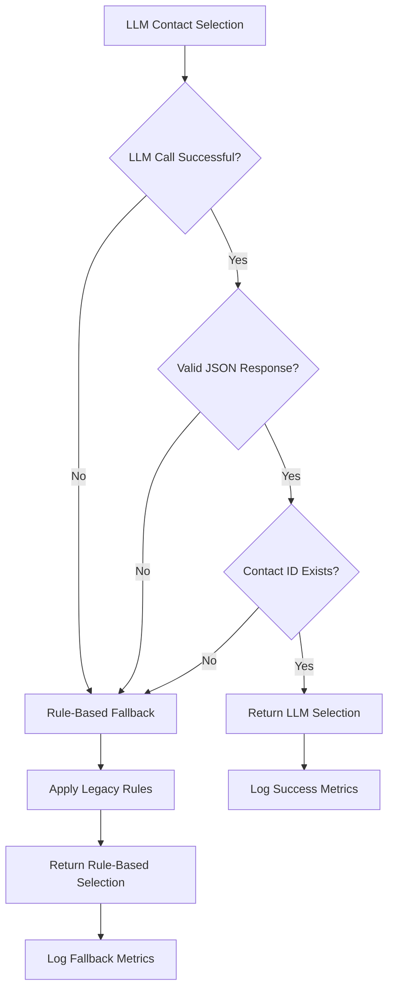

# LLM-Based Contact Selection - User Guide

_Last updated: 2025-01-27_

## Overview

The Lead Sorcerer enrichment system now includes intelligent LLM-based contact selection that automatically chooses the most relevant contacts based on your Ideal Customer Profile (ICP) business context. This guide explains how to configure, use, and troubleshoot the LLM contact selection system.

## Table of Contents

1. [Quick Start](#quick-start)
2. [Configuration Options](#configuration-options)
3. [Fallback Behavior](#fallback-behavior)
4. [ICP-Specific Settings](#icp-specific-settings)
5. [Prompt Customization](#prompt-customization)
6. [Monitoring and Metrics](#monitoring-and-metrics)
7. [Troubleshooting](#troubleshooting)
8. [Cost Management](#cost-management)

## Quick Start

### Basic Usage

The LLM contact selection is enabled by default. No additional configuration is required for basic usage:

```bash
# Standard enrichment with LLM contact selection
python -m src.orchestrator --config icp_config.json --input leads.csv
```

### Environment Setup

Ensure your OpenRouter API key is configured:

```bash
# Set in your environment
export OPENROUTER_API_KEY="your-api-key-here"

# Or in .env file
OPENROUTER_API_KEY=your-api-key-here
```

## Configuration Options

### ICP Configuration

Add LLM-specific settings to your ICP configuration file:

```json
{
  "icp_type": "investment",
  "icp_text": "Accredited, crypto-savvy capital allocators...",
  "llm_config": {
    "model": "gpt-4o-mini",
    "temperature": 0.0,
    "max_tokens": 600,
    "timeout": 30.0,
    "prompt_template": "investment_contact_selection.txt"
  },
  "role_priority_config": {
    "ceo": 1,
    "founder": 1,
    "managing partner": 2,
    "investment director": 2
  }
}
```

### Configuration Parameters

| Parameter         | Type    | Default                      | Description                |
| ----------------- | ------- | ---------------------------- | -------------------------- |
| `model`           | string  | "gpt-4o-mini"                | LLM model to use           |
| `temperature`     | float   | 0.0                          | Creativity level (0.0-1.0) |
| `max_tokens`      | integer | 500                          | Maximum response tokens    |
| `timeout`         | float   | 30.0                         | Request timeout in seconds |
| `prompt_template` | string  | "base_contact_selection.txt" | Prompt template file       |

### Global LLM Settings

Default configurations are defined in `src/enrich.py`:

```python
# Global LLM settings
LLM_MODEL = "gpt-4o-mini"
LLM_FALLBACK_MODEL = "gpt-3.5-turbo"
LLM_TEMPERATURE = 0.0
LLM_MAX_TOKENS = 500
LLM_TIMEOUT = 30.0
LLM_BASE_URL = "https://openrouter.ai/api/v1"

# Cache settings
LLM_CACHE_TTL = 3600  # 1 hour
LLM_CACHE_MAX_SIZE = 1000
LLM_CACHE_MAX_CONTACT_LIST_SIZE = 20
```

## Fallback Behavior

The system includes comprehensive fallback mechanisms to ensure reliable operation:

### Fallback Triggers

1. **LLM API Failures**

   - Network connectivity issues
   - API service outages
   - Authentication failures
   - Rate limiting (HTTP 429)

2. **Response Quality Issues**

   - Invalid JSON format
   - Missing `contact_id` field
   - Non-existent contact ID
   - Malformed responses

3. **Timeout Scenarios**
   - LLM response takes longer than configured timeout
   - Network timeouts
   - Service unavailability

### Fallback Process



### Fallback Metrics

The system tracks fallback usage for monitoring:

```python
FALLBACK_METRICS = {
    "llm_failures": 0,           # LLM API call failures
    "llm_none_responses": 0,     # LLM returned no selection
    "invalid_contact_ids": 0,    # Invalid contact IDs returned
    "total_fallbacks": 0         # Total fallback events
}
```

## ICP-Specific Settings

The system supports different configurations for various ICP types:

### Supported ICP Types

#### Investment ICPs

- **Use Case**: Family offices, VCs, investment funds
- **Temperature**: 0.0 (deterministic)
- **Max Tokens**: 600 (complex investment criteria)
- **Focus**: Capital allocation authority, investment decision-making

#### Healthcare ICPs

- **Use Case**: Medical practices, healthcare organizations
- **Temperature**: 0.0 (precise selection)
- **Max Tokens**: 500 (standard complexity)
- **Focus**: Practice ownership, medical leadership

#### Technology ICPs

- **Use Case**: Tech companies, engineering organizations
- **Temperature**: 0.1 (slight creativity)
- **Max Tokens**: 700 (complex technical roles)
- **Focus**: Technical leadership, engineering decisions

#### Enterprise ICPs

- **Use Case**: Large corporations, enterprise sales
- **Temperature**: 0.0 (precise selection)
- **Max Tokens**: 800 (complex organizations)
- **Timeout**: 45s (longer processing time)
- **Focus**: Executive leadership, business unit heads

#### Default ICPs

- **Use Case**: General business contacts
- **Temperature**: 0.0 (consistent selection)
- **Max Tokens**: 500 (standard complexity)
- **Focus**: General business decision-makers

### Configuration Override Example

```json
{
  "icp_type": "technology",
  "icp_text": "CTOs and engineering leaders at AI startups",
  "llm_config": {
    "temperature": 0.2,
    "max_tokens": 800,
    "timeout": 45.0
  }
}
```

## Prompt Customization

### Template System

Prompts are stored as template files in `config/prompts/`:

```
config/prompts/
├── base_contact_selection.txt
├── investment_contact_selection.txt
├── healthcare_contact_selection.txt
├── technology_contact_selection.txt
└── enterprise_contact_selection.txt
```

### Template Format

Templates use placeholder substitution:

```
ICP: {icp_text}

Select the BEST contact who can make technology business decisions. Prioritize:
- CTOs and technology executives
- Engineering directors and VPs
- Product managers and technical leads

AVOID: Marketing executives, consultants, or people without technology decision-making power.
{role_context}

Contacts:
{contacts}

Return ONLY a JSON response in this exact format:
{ "contact_id": "123" }
```

### Placeholders

| Placeholder      | Description            | Example                                    |
| ---------------- | ---------------------- | ------------------------------------------ |
| `{icp_text}`     | ICP description        | "CTOs at AI startups"                      |
| `{contacts}`     | Formatted contact list | "1. John Doe - CTO at TechCorp"            |
| `{role_context}` | High-priority roles    | "High Priority Roles: CTO, VP Engineering" |

### Custom Prompt Creation

1. Create a new template file in `config/prompts/`
2. Use the standard template format with placeholders
3. Reference the template in your ICP configuration:

```json
{
  "llm_config": {
    "prompt_template": "custom_template.txt"
  }
}
```

## Monitoring and Metrics

### Performance Metrics

The system tracks comprehensive metrics:

```python
# LLM Performance Metrics
{
    "total_calls": 150,
    "successful_calls": 142,
    "failed_calls": 8,
    "success_rate_percent": 94.67,
    "cache_hits": 45,
    "cache_misses": 105,
    "cache_hit_rate_percent": 30.0,
    "average_response_time_ms": 2340,
    "timeout_errors": 2,
    "rate_limit_errors": 1,
    "server_errors": 3,
    "invalid_responses": 2,
    "fallback_to_rule_based": 8,
    "fallback_rate_percent": 5.33
}
```

### Accessing Metrics

```python
from src.enrich import get_llm_performance_metrics, get_llm_monitoring_summary

# Get raw metrics
metrics = get_llm_performance_metrics()

# Get calculated summary
summary = get_llm_monitoring_summary()
print(f"Success Rate: {summary['calculated_metrics']['success_rate_percent']}%")
print(f"Cache Hit Rate: {summary['calculated_metrics']['cache_hit_rate_percent']}%")
```

### Cost Tracking

LLM costs are tracked and integrated with enrichment costs:

```python
# Cost information included in enrichment results
{
    "cost": {
        "total_usd": 0.045,
        "llm_usd": 0.008,
        "contacts_usd": 0.025,
        "company_usd": 0.012
    },
    "evidence": {
        "llm_contact_selection": {
            "cost_info": {
                "prompt_tokens": 245,
                "completion_tokens": 12,
                "cost_usd": 0.008
            },
            "model_used": "gpt-4o-mini",
            "response_time_ms": 2340,
            "cache_hit": false
        }
    }
}
```

## Troubleshooting

### Common Issues

#### 1. LLM Selection Not Working

**Symptoms**: Always falling back to rule-based selection

**Causes & Solutions**:

- Missing API key: Set `OPENROUTER_API_KEY` environment variable
- Network issues: Check connectivity to openrouter.ai
- Invalid configuration: Verify ICP config format

#### 2. High Fallback Rate

**Symptoms**: `fallback_rate_percent` > 20%

**Causes & Solutions**:

- Rate limiting: Implement request throttling
- Invalid prompts: Check template format and placeholders
- Model issues: Try different model or fallback model

#### 3. Poor Selection Quality

**Symptoms**: Selected contacts don't match ICP criteria

**Causes & Solutions**:

- Unclear ICP text: Improve ICP description clarity
- Wrong template: Use appropriate ICP-specific template
- Temperature too high: Reduce temperature for more deterministic results

#### 4. High Response Times

**Symptoms**: `average_response_time_ms` > 5000

**Causes & Solutions**:

- Network latency: Check network connection
- Complex prompts: Reduce max_tokens or simplify prompts
- Model overload: Switch to faster model or implement caching

### Debug Mode

Enable detailed logging for debugging:

```python
import logging
logging.getLogger("src.enrich").setLevel(logging.DEBUG)
```

### Metric Reset

Reset metrics for testing or monitoring:

```python
from src.enrich import reset_llm_performance_metrics, reset_fallback_metrics

reset_llm_performance_metrics()
reset_fallback_metrics()
```

## Cost Management

### Cost Optimization Strategies

1. **Enable Caching**

   - Default cache TTL: 1 hour
   - Reduces redundant API calls
   - Significant cost savings for repeated contact lists

2. **Optimize Token Usage**

   - Use appropriate max_tokens for ICP complexity
   - Shorter prompts reduce cost
   - Cache results for similar contact sets

3. **Model Selection**
   - `gpt-4o-mini`: Cost-effective, good performance
   - `gpt-3.5-turbo`: Lower cost fallback option
   - Monitor cost per selection

### Cost Budgeting

Set budget limits in your ICP configuration:

```json
{
  "cost_limits": {
    "max_cost_per_lead_usd": 0.5,
    "max_llm_cost_per_selection_usd": 0.02,
    "monthly_budget_usd": 100.0
  }
}
```

### Cost Monitoring

Track LLM costs separately:

```bash
# View cost breakdown
python -c "
from src.enrich import get_llm_monitoring_summary
summary = get_llm_monitoring_summary()
print('LLM Costs:', summary.get('cost_info', {}))
"
```

## Best Practices

### Configuration

1. **Start with defaults** for your ICP type
2. **Test thoroughly** before production deployment
3. **Monitor metrics** regularly for optimization opportunities
4. **Use caching** to reduce costs and improve performance

### Prompt Engineering

1. **Be specific** about selection criteria
2. **Include clear examples** of desired vs. undesired contacts
3. **Test prompts** with sample contact lists
4. **Version control** prompt templates

### Monitoring

1. **Set up alerts** for high fallback rates
2. **Monitor costs** to stay within budget
3. **Track selection quality** through manual review
4. **Regular performance reviews** and optimization

### Troubleshooting

1. **Check logs** for error details
2. **Verify configuration** before investigating complex issues
3. **Test with simple examples** to isolate problems
4. **Use fallback metrics** to identify improvement areas

---

For additional support or questions, refer to the enrichment architecture documentation or contact the development team.


