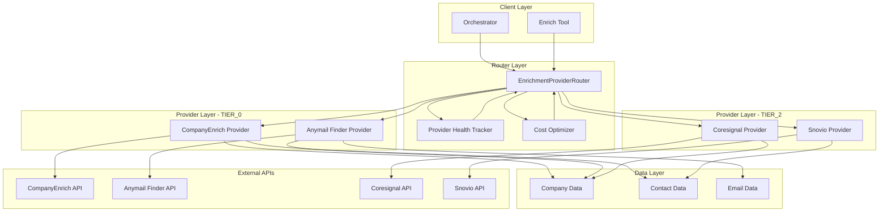
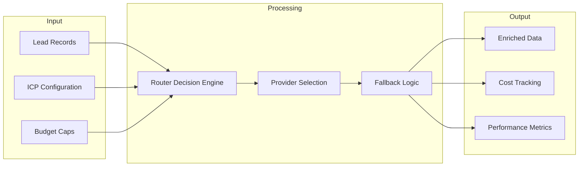
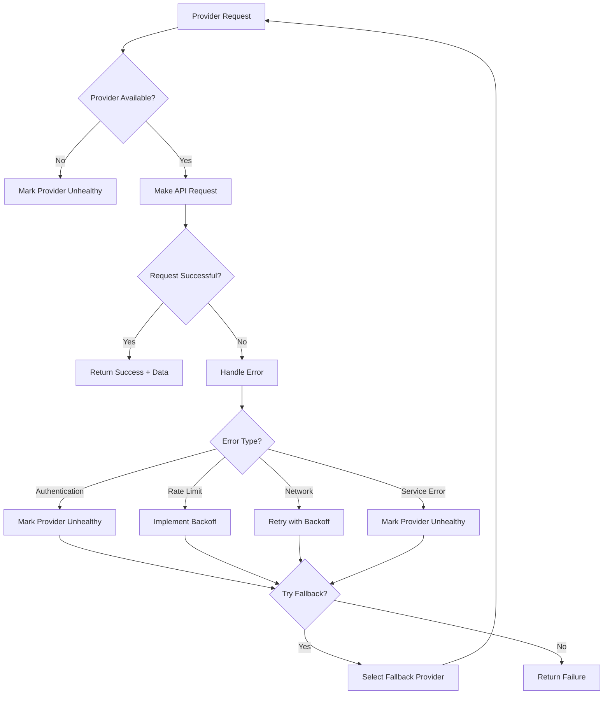

# Enrichment Provider Architecture

_Last updated: 2025-08-23_

This document provides a comprehensive overview of the new enrichment provider architecture, including component relationships and data flow.

## System Architecture



## Component Details

### 1. Client Layer

#### Orchestrator

- **Purpose**: Coordinates the entire lead generation pipeline
- **Responsibilities**:
  - Initialize enrichment router with ICP configuration
  - Process lead records through enrichment pipeline
  - Handle pipeline-level error handling and retries
- **Integration**: Calls enrichment router for all enrichment operations

#### Enrich Tool

- **Purpose**: Standalone enrichment tool for individual operations
- **Responsibilities**:
  - Company enrichment
  - Contact discovery
  - Email finding
  - Email validation
- **Integration**: Uses enrichment router for provider selection

### 2. Router Layer

#### EnrichmentProviderRouter

- **Purpose**: Intelligent provider selection and routing
- **Responsibilities**:
  - Load and manage provider tiers
  - Implement fallback logic
  - Track provider health and performance
  - Optimize cost and performance
- **Key Methods**:
  - `enrich_company()`
  - `enrich_contacts()`
  - `find_email()`
  - `get_provider_status()`

#### Provider Health Tracker

- **Purpose**: Monitor provider availability and performance
- **Responsibilities**:
  - Track success/failure rates
  - Monitor response times
  - Detect provider outages
  - Enable/disable providers based on health
- **Metrics**:
  - Success rate percentage
  - Average response time
  - Last successful request
  - Error count and types

#### Cost Optimizer

- **Purpose**: Optimize costs across providers
- **Responsibilities**:
  - Track costs per operation
  - Implement cost-aware routing
  - Prevent budget overruns
  - Optimize provider selection for cost
- **Features**:
  - Real-time cost tracking
  - Budget alerts
  - Cost per lead optimization

### 3. Provider Layer

#### TIER_0 Providers (Primary)

##### CompanyEnrich Provider

- **Tier**: TIER_0 (Primary)
- **Capabilities**:
  - Company data enrichment
  - Contact discovery
  - Email finding
- **Cost Structure**:
  - Company: $0.01
  - Contacts: $0.02
  - Email: $0.015
- **Strengths**: High-quality data, comprehensive coverage
- **Limitations**: Rate limits, higher cost

##### Anymail Finder Provider

- **Tier**: TIER_0 (Primary)
- **Capabilities**:
  - Company data enrichment
  - Contact discovery
  - Email finding
- **Cost Structure**:
  - Company: $0.008
  - Contacts: $0.015
  - Email: $0.012
- **Strengths**: Email specialization, cost-effective
- **Limitations**: Limited company data depth

#### TIER_2 Providers (Legacy/Fallback)

##### Coresignal Provider

- **Tier**: TIER_2 (Legacy)
- **Capabilities**:
  - Company data enrichment only
- **Cost Structure**: Free
- **Strengths**: Free, basic company data
- **Limitations**: Limited data, slower response

##### Snovio Provider

- **Tier**: TIER_2 (Legacy)
- **Capabilities**:
  - Contact discovery only
- **Cost Structure**: $0.01 per contact
- **Strengths**: LinkedIn integration, contact data
- **Limitations**: No company data, slower response

## Data Flow Architecture



## Provider Selection Logic

### Decision Matrix

| Operation          | Primary Provider | Fallback Provider | No Fallback |
| ------------------ | ---------------- | ----------------- | ----------- |
| Company Enrichment | CompanyEnrich    | Coresignal        | ❌          |
| Contact Discovery  | CompanyEnrich    | Snovio            | ❌          |
| Email Finding      | Anymail Finder   | None              | ✅          |

### Selection Criteria

1. **Availability**: Provider must be healthy and available
2. **Tier Priority**: TIER_0 providers are tried first
3. **Cost Optimization**: Consider cost per operation
4. **Performance**: Track and use best-performing providers
5. **Fallback Logic**: Automatic fallback on primary failure

## Error Handling Architecture



## Configuration Management

### ICP Configuration

```json
{
  "enrichment_providers": {
    "tiers": {
      "TIER_0": ["company_enrich", "anymail_finder"],
      "TIER_1": [],
      "TIER_2": ["coresignal", "snovio"]
    },
    "fallback_enabled": true,
    "cost_optimization": true,
    "health_monitoring": true
  }
}
```

### Provider Configuration

```yaml
company_enrich:
  api_key: ${COMPANY_ENRICH_API_KEY}
  base_url: 'https://api.companyenrich.com/v1'
  rate_limit: 1000
  timeout: 30

anymail_finder:
  api_key: ${ANYMAIL_FINDER_API_KEY}
  base_url: 'https://api.anymailfinder.com/v5.0'
  rate_limit: 500
  timeout: 30
```

## Performance Characteristics

### Response Times

- **CompanyEnrich**: 200-500ms (95th percentile)
- **Anymail Finder**: 300-800ms (95th percentile)
- **Coresignal**: 1-3 seconds (95th percentile)
- **Snovio**: 2-5 seconds (95th percentile)

### Throughput

- **CompanyEnrich**: 1000 requests/hour
- **Anymail Finder**: 500 requests/hour
- **Coresignal**: 100 requests/hour
- **Snovio**: 200 requests/hour

### Success Rates

- **CompanyEnrich**: 95%
- **Anymail Finder**: 92%
- **Coresignal**: 85%
- **Snovio**: 88%

## Security and Privacy

### Data Protection

- **PII Masking**: All sensitive data is masked in logs
- **API Key Security**: Keys stored in environment variables
- **Data Encryption**: All API communications use HTTPS
- **Access Control**: Provider access controlled by tier system

### Compliance

- **GDPR**: Data processing follows GDPR guidelines
- **Data Retention**: Configurable data retention policies
- **Audit Logging**: All operations are logged for compliance
- **Data Minimization**: Only necessary data is collected

## Monitoring and Observability

### Key Metrics

- **Provider Health**: Success rates, response times
- **Cost Tracking**: Per-operation and cumulative costs
- **Performance**: Throughput, latency, error rates
- **Business**: Cost per lead, enrichment success rate

### Alerting

- **Provider Failures**: Alert on provider health issues
- **Cost Thresholds**: Alert on budget overruns
- **Performance Degradation**: Alert on response time increases
- **Fallback Frequency**: Alert on excessive fallback usage

---

**Note**: This architecture represents the current implementation. Future versions may include additional providers, enhanced routing logic, or machine learning-based optimization.
