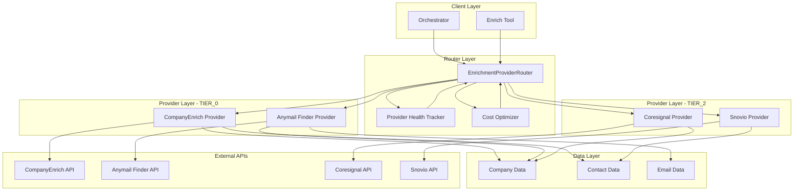
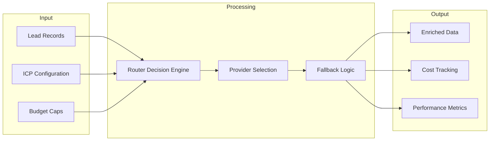
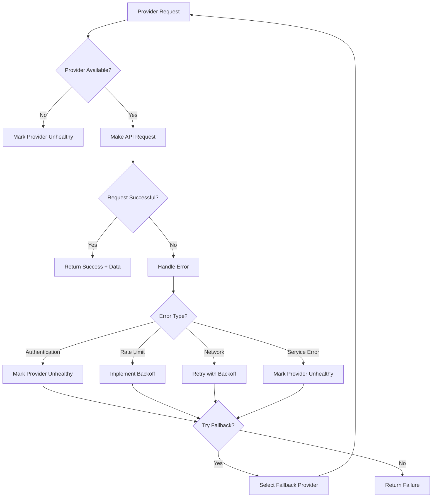
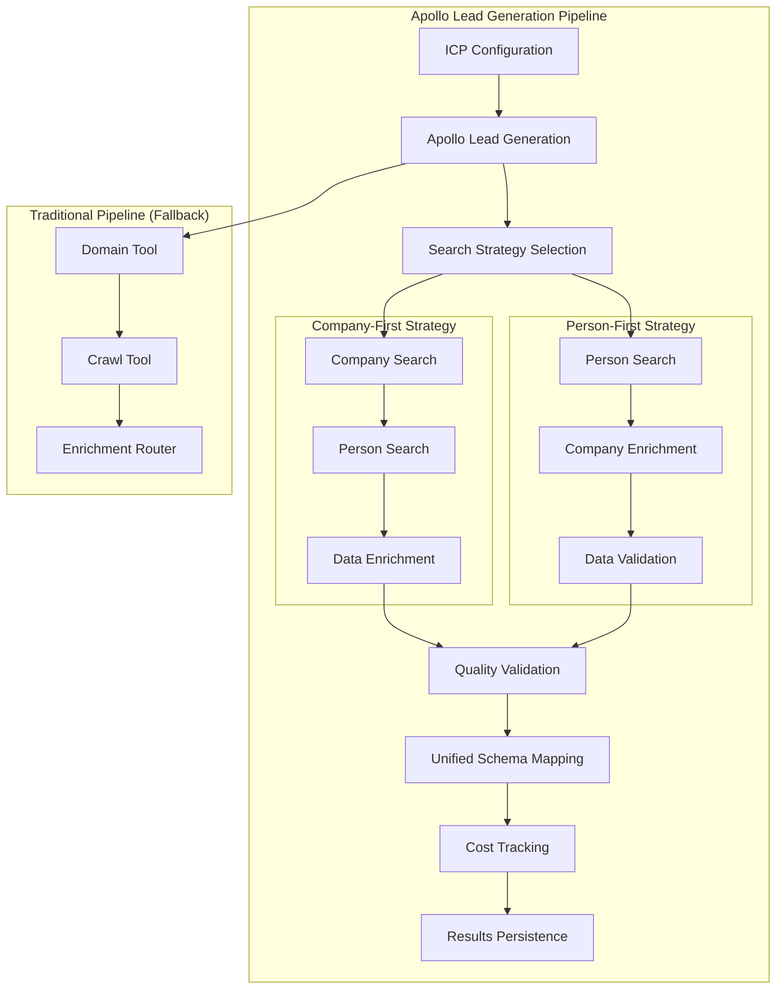
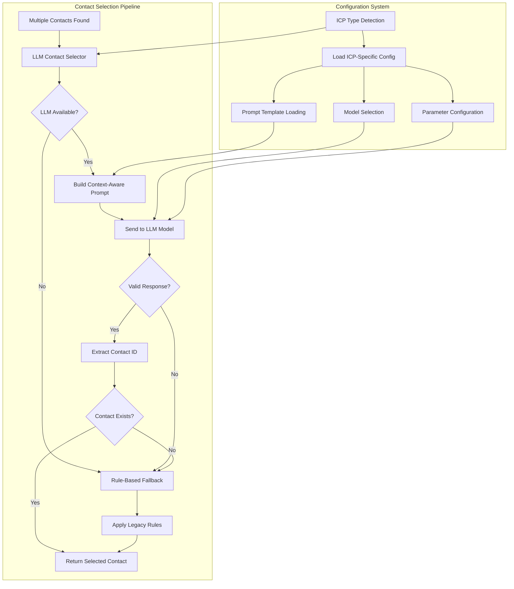

# Enrichment Provider Architecture

_Last updated: 2025-08-23_

This document provides a comprehensive overview of the new enrichment provider architecture, including component relationships and data flow.

## System Architecture



## Component Details

### 1. Client Layer

#### Orchestrator

- **Purpose**: Coordinates the entire lead generation pipeline
- **Responsibilities**:
  - Initialize enrichment router with ICP configuration
  - Process lead records through enrichment pipeline
  - Handle pipeline-level error handling and retries
- **Integration**: Calls enrichment router for all enrichment operations

#### Enrich Tool

- **Purpose**: Standalone enrichment tool for individual operations
- **Responsibilities**:
  - Company enrichment
  - Contact discovery
  - Email finding
  - Email validation
- **Integration**: Uses enrichment router for provider selection

### 2. Router Layer

#### EnrichmentProviderRouter

- **Purpose**: Intelligent provider selection and routing
- **Responsibilities**:
  - Load and manage provider tiers
  - Implement fallback logic
  - Track provider health and performance
  - Optimize cost and performance
- **Key Methods**:
  - `enrich_company()`
  - `enrich_contacts()`
  - `find_email()`
  - `get_provider_status()`

#### Provider Health Tracker

- **Purpose**: Monitor provider availability and performance
- **Responsibilities**:
  - Track success/failure rates
  - Monitor response times
  - Detect provider outages
  - Enable/disable providers based on health
- **Metrics**:
  - Success rate percentage
  - Average response time
  - Last successful request
  - Error count and types

#### Cost Optimizer

- **Purpose**: Optimize costs across providers
- **Responsibilities**:
  - Track costs per operation
  - Implement cost-aware routing
  - Prevent budget overruns
  - Optimize provider selection for cost
- **Features**:
  - Real-time cost tracking
  - Budget alerts
  - Cost per lead optimization

### 3. Provider Layer

#### TIER_0 Providers (Primary)

##### CompanyEnrich Provider

- **Tier**: TIER_0 (Primary)
- **Capabilities**:
  - Company data enrichment
  - Contact discovery
  - Email finding
- **Cost Structure**:
  - Company: $0.01
  - Contacts: $0.02
  - Email: $0.015
- **Strengths**: High-quality data, comprehensive coverage
- **Limitations**: Rate limits, higher cost

##### Anymail Finder Provider

- **Tier**: TIER_0 (Primary)
- **Capabilities**:
  - Company data enrichment
  - Contact discovery
  - Email finding
- **Cost Structure**:
  - Company: $0.008
  - Contacts: $0.015
  - Email: $0.012
- **Strengths**: Email specialization, cost-effective
- **Limitations**: Limited company data depth

#### TIER_2 Providers (Legacy/Fallback)

##### Coresignal Provider

- **Tier**: TIER_2 (Legacy)
- **Capabilities**:
  - Company data enrichment only
- **Cost Structure**: Free
- **Strengths**: Free, basic company data
- **Limitations**: Limited data, slower response

##### Snovio Provider

- **Tier**: TIER_2 (Legacy)
- **Capabilities**:
  - Contact discovery only
- **Cost Structure**: $0.01 per contact
- **Strengths**: LinkedIn integration, contact data
- **Limitations**: No company data, slower response

#### Apollo Provider (Lead Generation & Enrichment)

- **Tier**: TIER_0 (Primary - Lead Generation)
- **Capabilities**:
  - **Lead Generation**: Company and person search with advanced filtering
  - **Company Enrichment**: Comprehensive company data enrichment
  - **Contact Enrichment**: Person data enrichment and contact discovery
  - **Data Quality**: Built-in quality validation and scoring
- **Cost Structure**:
  - Search: 1 credit ($0.015) per request
  - Enrichment: 1 credit ($0.015) per request
  - Credits can be used for both search and enrichment
- **Strengths**:
  - High-quality lead generation with ICP-based filtering
  - Comprehensive company and contact data
  - Advanced search strategies (company-first, person-first)
  - Built-in data quality validation
  - Can bypass traditional Domain + Crawl pipeline
- **Limitations**:
  - Credit-based pricing model
  - Rate limiting (60 req/min, 1000 req/hour)
  - Requires Apollo API access
- **Integration**:
  - Primary lead generation tool when `lead_generation_mode: "apollo"`
  - Enrichment provider within traditional pipeline
  - Supports hybrid workflows with fallback to traditional mode

## Data Flow Architecture



## Provider Selection Logic

### Decision Matrix

| Operation           | Primary Provider | Fallback Provider | No Fallback |
| ------------------- | ---------------- | ----------------- | ----------- |
| Company Enrichment  | CompanyEnrich    | Apollo            | ❌          |
| Contact Discovery   | CompanyEnrich    | Apollo            | ❌          |
| Email Finding       | Anymail Finder   | None              | ✅          |
| **Lead Generation** | **Apollo**       | **Traditional**   | **✅**      |

### Selection Criteria

1. **Availability**: Provider must be healthy and available
2. **Tier Priority**: TIER_0 providers are tried first
3. **Cost Optimization**: Consider cost per operation
4. **Performance**: Track and use best-performing providers
5. **Fallback Logic**: Automatic fallback on primary failure

## Error Handling Architecture



## Apollo Lead Generation Flow

### Overview

Apollo integration provides an alternative lead generation path that can bypass the traditional Domain + Crawl tools while maintaining all existing functionality. The system supports three modes:

1. **Traditional Mode**: Domain → Crawl → Enrich (default)
2. **Apollo Mode**: Apollo Search + Enrich (when `lead_generation_mode: "apollo"`)
3. **Hybrid Mode**: Apollo enrichment within traditional pipeline

### Apollo Pipeline Architecture



### Search Strategies

#### Company-First Strategy

1. **Company Search**: Find companies matching ICP criteria
2. **Person Discovery**: Search for people within those companies
3. **Data Enrichment**: Enrich both company and person data
4. **Quality Validation**: Apply quality thresholds and scoring

#### Person-First Strategy

1. **Person Search**: Find people matching ICP criteria
2. **Company Discovery**: Identify companies from person data
3. **Company Enrichment**: Enrich company information
4. **Data Validation**: Validate and score lead quality

### Integration Points

- **Orchestrator**: Dynamically switches between Apollo and traditional pipelines
- **Enrichment Router**: Apollo serves as TIER_0 enrichment provider
- **Data Mapper**: Converts Apollo data to unified lead record schema
- **Quality Engine**: Applies ICP-based quality validation
- **Cost Tracker**: Monitors Apollo credit usage and costs

## Configuration Management

### ICP Configuration

```json
{
  "lead_generation_mode": "apollo",
  "enrichment_providers": {
    "tiers": {
      "TIER_0": ["company_enrich", "anymail_finder", "apollo"],
      "TIER_1": [],
      "TIER_2": ["coresignal", "snovio"]
    },
    "fallback_enabled": true,
    "cost_optimization": true,
    "health_monitoring": true
  },
  "apollo": {
    "enabled": true,
    "search": {
      "strategy": "company_first",
      "company_filters": {
        "industry": ["Technology", "SaaS"],
        "size": ["11-50", "51-200"],
        "location": ["United States"],
        "technologies": ["Python", "AWS"],
        "funding_stage": ["Series A", "Series B"]
      },
      "person_filters": {
        "job_titles": ["CEO", "CTO", "VP Engineering"],
        "seniority": ["C-Level", "VP"],
        "departments": ["Engineering", "Sales"]
      },
      "max_results": 100
    },
    "enrich": {
      "enabled": true,
      "quality_thresholds": {
        "min_employee_count": 10,
        "min_funding_stage": "Seed",
        "required_technologies": ["Python"]
      }
    }
  }
}
```

### Provider Configuration

```yaml
company_enrich:
  api_key: ${COMPANY_ENRICH_API_KEY}
  base_url: 'https://api.companyenrich.com/v1'
  rate_limit: 1000
  timeout: 30

anymail_finder:
  api_key: ${ANYMAIL_FINDER_API_KEY}
  base_url: 'https://api.anymailfinder.com/v5.0'
  rate_limit: 500
  timeout: 30
```

## Performance Characteristics

### Response Times

- **CompanyEnrich**: 200-500ms (95th percentile)
- **Anymail Finder**: 300-800ms (95th percentile)
- **Coresignal**: 1-3 seconds (95th percentile)
- **Snovio**: 2-5 seconds (95th percentile)

### Throughput

- **CompanyEnrich**: 1000 requests/hour
- **Anymail Finder**: 500 requests/hour
- **Coresignal**: 100 requests/hour
- **Snovio**: 200 requests/hour

### Success Rates

- **CompanyEnrich**: 95%
- **Anymail Finder**: 92%
- **Coresignal**: 85%
- **Snovio**: 88%

## Security and Privacy

### Data Protection

- **PII Masking**: All sensitive data is masked in logs
- **API Key Security**: Keys stored in environment variables
- **Data Encryption**: All API communications use HTTPS
- **Access Control**: Provider access controlled by tier system

### Compliance

- **GDPR**: Data processing follows GDPR guidelines
- **Data Retention**: Configurable data retention policies
- **Audit Logging**: All operations are logged for compliance
- **Data Minimization**: Only necessary data is collected

## LLM-Based Contact Selection

### Overview

The enrichment system now includes an intelligent LLM-based contact selection mechanism that replaces the traditional rule-based approach. This system uses OpenAI GPT models to select the most relevant contacts based on ICP (Ideal Customer Profile) business context.

### Architecture



### Key Components

#### 1. LLMContactSelector Class

```python
class LLMContactSelector:
    def __init__(self, api_key: str, icp_type: str = "default", icp_config: Optional[Dict[str, Any]] = None):
        # Initialize with ICP-specific configuration
        self.client = AsyncOpenAI(api_key=api_key, base_url=LLM_BASE_URL)
        config = get_icp_llm_config(icp_type, icp_config)
        self.primary_model = config["model"]
        self.prompt_template = config["prompt_template"]
        # ... additional configuration
```

#### 2. Configuration per ICP Type

| ICP Type       | Model       | Temperature | Max Tokens | Timeout | Prompt Template                  |
| -------------- | ----------- | ----------- | ---------- | ------- | -------------------------------- |
| **Investment** | gpt-4o-mini | 0.0         | 600        | 30s     | investment_contact_selection.txt |
| **Healthcare** | gpt-4o-mini | 0.0         | 500        | 30s     | healthcare_contact_selection.txt |
| **Technology** | gpt-4o-mini | 0.1         | 700        | 30s     | technology_contact_selection.txt |
| **Enterprise** | gpt-4o-mini | 0.0         | 800        | 45s     | enterprise_contact_selection.txt |
| **Default**    | gpt-4o-mini | 0.0         | 500        | 30s     | base_contact_selection.txt       |

#### 3. Prompt Engineering

**Investment ICP Example:**

```
ICP: "Accredited, crypto-savvy capital allocators seeking asymmetric exposure to decentralized-AI tokens"

Select the BEST contact who can actually allocate capital or make investment decisions. Prioritize:
- Family office decision makers
- Investment fund founders/managers
- Capital allocators with crypto exposure
- HNW individuals with investment capacity

AVOID: Marketing executives, consultants, or people without investment decision-making power.

Contacts:
1. John Smith - CEO at Investment Fund ABC (Seniority: 1)
2. Jane Doe - Marketing Director at Fund XYZ (Seniority: 3)

Return ONLY a JSON response: { "contact_id": "123" }
```

### Selection Process

#### 1. Context Building

- **ICP Analysis**: Extract business context from ICP configuration
- **Role Prioritization**: Apply ICP-specific role priorities
- **Contact Formatting**: Format contacts for LLM consumption
- **Prompt Construction**: Build context-aware prompts

#### 2. LLM Processing

- **Model Selection**: Choose appropriate model for ICP type
- **Parameter Configuration**: Apply ICP-specific temperature, tokens, timeout
- **API Request**: Send structured prompt to OpenAI
- **Response Validation**: Validate JSON format and contact existence

#### 3. Fallback Mechanism

- **LLM Failure**: Network errors, timeouts, rate limits
- **Invalid Response**: Malformed JSON, missing contact_id
- **Non-existent Contact**: Contact ID not in original list
- **Rule-based Fallback**: Legacy selection logic as backup

### Performance Monitoring

#### LLM Metrics Tracked

```python
LLM_PERFORMANCE_METRICS = {
    "total_calls": 0,
    "successful_calls": 0,
    "failed_calls": 0,
    "timeout_errors": 0,
    "rate_limit_errors": 0,
    "server_errors": 0,
    "invalid_responses": 0,
    "fallback_to_rule_based": 0,
    "cache_hits": 0,
    "cache_misses": 0,
    "total_response_time_ms": 0,
    "average_response_time_ms": 0
}
```

#### Cost Tracking

- **Per-call Costs**: Tracked using OpenRouter pricing
- **Token Usage**: Prompt and completion tokens monitored
- **Budget Integration**: Costs added to enrichment metrics
- **Cost Optimization**: Caching to reduce redundant calls

#### Response Quality Analysis

```python
def analyze_llm_response_quality(response: str, contacts: List[Dict]) -> Dict[str, Any]:
    return {
        "is_valid_json": bool,
        "has_contact_id": bool,
        "contact_id_exists": bool,
        "quality_score": float,  # 0.0 to 1.0
        "quality_issues": List[str]
    }
```

### Error Handling

#### Comprehensive Error Recovery

1. **Network Errors**: Retry with exponential backoff
2. **Rate Limiting**: Implement intelligent backoff strategies
3. **Authentication**: Fail fast and alert
4. **Service Errors**: Automatic fallback to rule-based selection
5. **Invalid Responses**: Parse and validate, fallback on failure

#### Fallback Triggers

- LLM API unavailable or timing out
- Invalid JSON response format
- Missing or invalid contact_id
- Contact ID not found in original list
- Authentication or authorization failures

### Caching Strategy

#### In-Memory Cache

- **Cache Key**: Hash of contacts + ICP type + role priorities
- **TTL**: 1 hour default
- **Size Limits**: 1000 responses max, 20 contacts max per list
- **LRU Eviction**: Oldest entries removed when cache full

#### Performance Impact

- **Cache Hit**: ~1ms response time
- **Cache Miss**: ~2-5s LLM API call
- **Memory Usage**: ~10MB for 1000 cached responses

### Integration Points

#### Orchestrator Integration

```python
# In orchestrator.py - LLM-based selection is now default
best_contact_id, cost_info = await select_best_contact_llm(contacts, icp_config)
if best_contact_id:
    # Use LLM selection
    record["best_contact"] = best_contact_id
    record["cost"]["llm_usd"] = cost_info.get("cost_usd", 0)
else:
    # Fallback to rule-based
    best_contact_id = select_best_contact(contacts, icp_config)
```

#### Evidence Tracking

```python
evidence_data["llm_contact_selection"] = {
    "best_contact_id": best_contact_id,
    "cost_info": cost_info,
    "model_used": model_name,
    "fallback_reason": fallback_reason or None,
    "response_time_ms": response_time,
    "cache_hit": cache_hit
}
```

### Business Benefits

#### Intelligent Selection

- **Context Awareness**: Understands business context beyond simple rules
- **Industry Expertise**: Tailored selection criteria per ICP type
- **Decision Making**: Mimics human judgment for contact relevance

#### Operational Efficiency

- **Reduced Manual Review**: Higher accuracy reduces need for manual contact validation
- **Scalable Intelligence**: Easily adapt to new ICP types and requirements
- **Performance Monitoring**: Comprehensive metrics for optimization

#### Cost Effectiveness

- **Optimized Calls**: Caching reduces redundant API usage
- **Smart Fallbacks**: Rule-based backup ensures no service interruption
- **ROI Tracking**: Detailed cost tracking enables ROI analysis

## Monitoring and Observability

### Key Metrics

- **Provider Health**: Success rates, response times
- **Cost Tracking**: Per-operation and cumulative costs
- **Performance**: Throughput, latency, error rates
- **Business**: Cost per lead, enrichment success rate
- **LLM Performance**: Selection accuracy, response times, fallback rates
- **Contact Quality**: Selection relevance, business context alignment

### Alerting

- **Provider Failures**: Alert on provider health issues
- **Cost Thresholds**: Alert on budget overruns
- **Performance Degradation**: Alert on response time increases
- **Fallback Frequency**: Alert on excessive fallback usage
- **LLM Failures**: Alert on high LLM failure rates or excessive fallbacks
- **Contact Quality**: Alert on poor selection quality or high manual override rates

---

**Note**: This architecture represents the current implementation including the new LLM-based contact selection system. The system provides intelligent, context-aware contact selection while maintaining robust fallback mechanisms for reliability.
