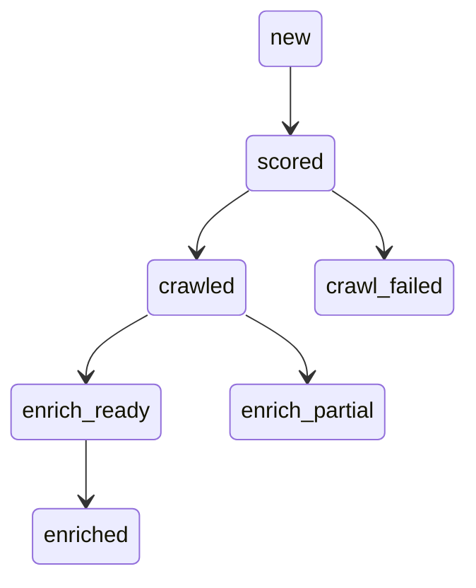

# Lead-Sorcerer BRD (LLM-Friendly Edition)

## 1. Overview

A single-pass pipeline (Domain ➜ Crawl ➜ Enrich) produces canonical `lead_records`.
This BRD is the authoritative contract for:
• Interfaces & schemas
• Caching, TTL & revisit policy
• Error codes & masking
• Cost accounting
• State-machine transitions

## 2. Global Constraints

1. Exactly **three** tools - `tools/domain.py`, `tools/crawl.py`, `tools/enrich.py`.
2. No cross-imports; no shared utils.
3. Allowed third-party libs: … _(same list as original)_
4. All timestamps → ISO-8601 UTC (`Z` suffix).

## 3. ID & Normalisation Rules

1. `lead_id  = uuid5(uuid.NAMESPACE_DNS,  eTLD+1)`
2. `contact_id = uuid5(uuid.NAMESPACE_URL, f"{domain}|{normalized_full_name}|{normalized_role}|{linkedin or ''}")`
3. Normalisers
   • `normalized_full_name`, `normalized_role` → trim, collapse WS, lowercase, Unicode NFKD fold
   • Phone → E.164 (see §5.4)
4. IDs are deterministic; never re-generate on re-runs.

## 4. Refresh & Revisit Policy

| Config Key                            | Default | Description     |
| ------------------------------------- | ------- | --------------- |
| `refresh_policy.revisit_after_days`   | 90      | Successful runs |
| `refresh_policy.failure_revisit_days` | 1       | Failures        |
| …                                     |

On update, always apply **max-rule**:
`provenance.next_revisit_at = max(existing, now + revisit_after_days)`.

## 5. Data Handling

### 5.1 File & Directory Conventions

- `data/evidence/domain/{eTLD+1}.json` – SERP snapshots
- `data/crawl_artifacts/{eTLD+1}.json` – Firecrawl results
  – _(full table kept as-is)_

### 5.2 Artifact GC (nightly orchestrator)

1. Keep last **3** versions per domain.
2. Delete >365 days old unless referenced in any `provenance.evidence_paths.*`.
3. Tools **never** delete files.

### 5.3 Masking Rules (deterministic & idempotent)

| PII Type | Stored in record? | Mask Example                |
| -------- | ----------------- | --------------------------- |
| Email    | No                | `j***@domain.com`           |
| Phone    | No                | `+XXXXXXXX7890`             |
| LinkedIn | Yes (normalised)  | `/in/***` or `/company/***` |

### 5.4 Phone Normalisation

Parse order:

1. `company.hq_location.country`
2. `icp_config.default_country`
   If still ambiguous → emit `PARSE_ERROR`.

## 6. Canonical JSON Schema

```json
{ ... }   // full schema pasted unchanged
```

_(kept verbatim; fenced for readability)_

## 7. Authoritative State Machine



Allowed transitions & gating rules:

| From    | To           | Gate                                                        |
| ------- | ------------ | ----------------------------------------------------------- |
| scored  | crawled      | —                                                           |
| crawled | enrich_ready | `icp.crawl_score ≥ icp.threshold` & required company fields |
| …       |

## 8. Tool-Specific Contracts

### 8.1 Domain (`tools/domain.py`)

**Purpose** Generate qualified domains via SERP + cheap LLM scoring.

**Inputs**
`icp_config` → { name, icp_text, queries, required_fields, … }

**Behaviour (high-level)**

1. Generate `lead_id`.
2. SERP via GSE (pages = 1 | 5 per mode).
3. … _(ordered bullet list of original steps)_

**Outputs**
Canonical `lead_records[]`; each record:

- `icp.pre_pass = icp.pre_score ≥ icp.threshold`
- status `"scored"`

_(Repeat the same compact template for Crawl and Enrich.)_

## 9. Error Contract

| Code          | Retryable? | Typical Source             |
| ------------- | ---------- | -------------------------- |
| `HTTP_429`    | ✓          | Provider 429 after retries |
| `DNS_FAILURE` | ✗          | DNS resolution error       |
| …             |

On uncaught exceptions emit:

```json
{
  "code": "UNKNOWN",
  "retryable": false,
  "message": "<ExceptionClass>: <truncated>"
}
```

## 10. Metrics

Every tool returns:

```json
{
  "count_in":  int,
  "count_out": int,
  "duration_ms": int,
  "cache_hit_rate": float | null,
  "pass_rate": float | null,
  "cost_usd": { "domain": 0.0, "crawl": 0.0, "enrich": 0.0, "total": 0.0 }
}
```

_All floats rounded to 4 decimals._

## 11. Versioning Policy

| Level | Trigger Examples            |
| ----- | --------------------------- |
| MAJOR | Envelope shape change       |
| MINOR | Schema field semantics      |
| PATCH | Prompt tweak / retry tuning |

Tools stamp `provenance.tool_versions.<tool> = { version, schema_version }` every run.

---
